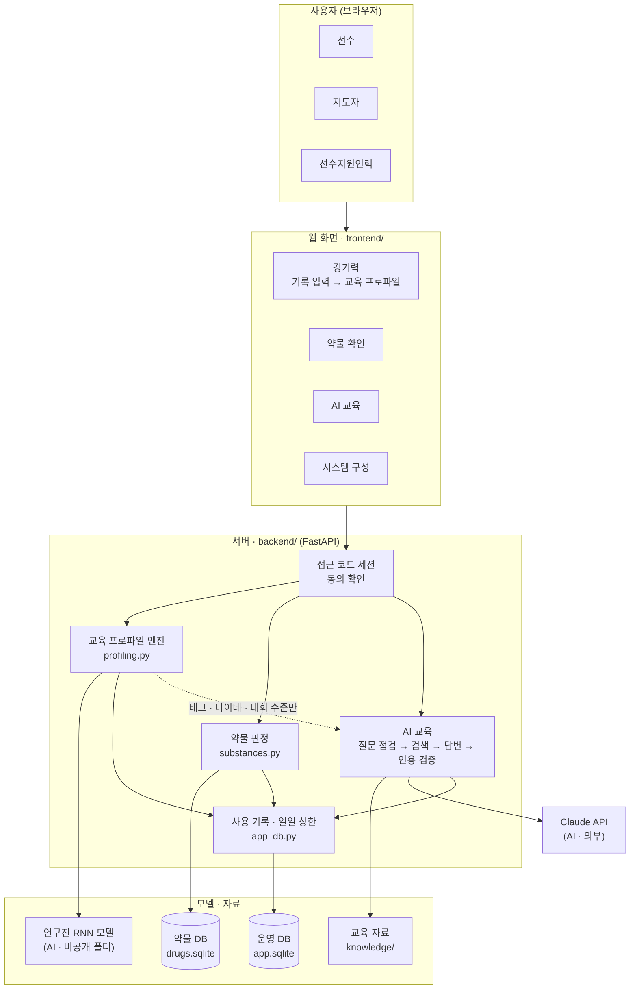
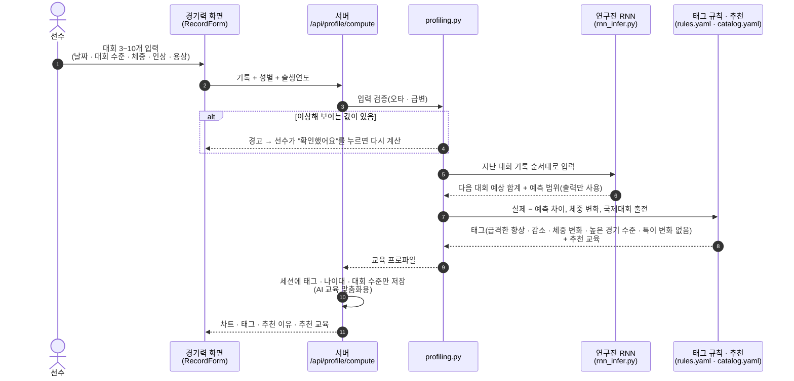
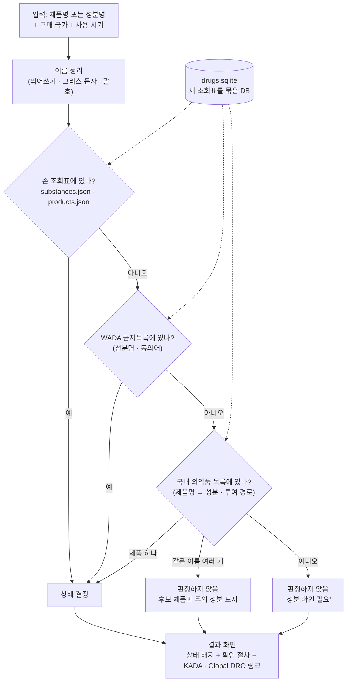
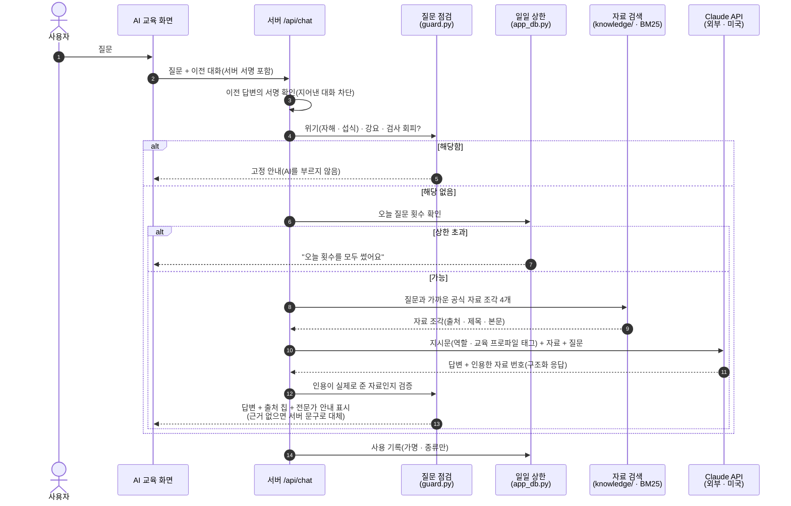
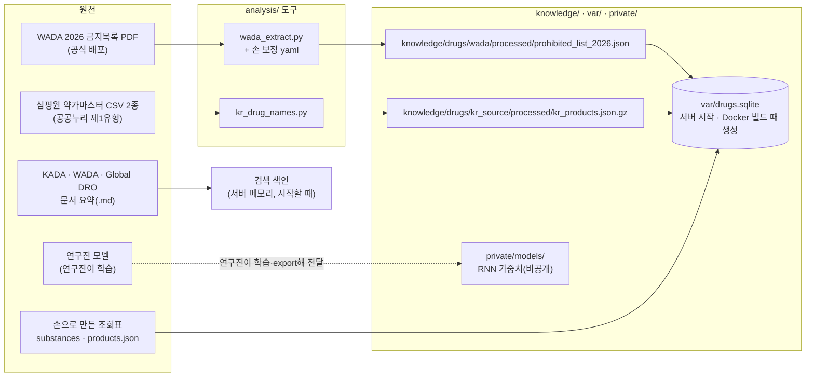
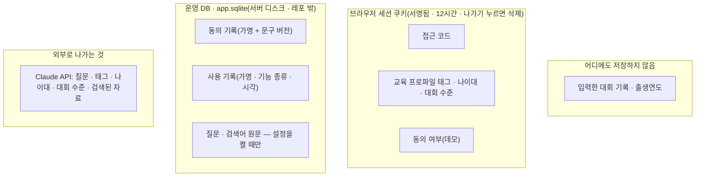
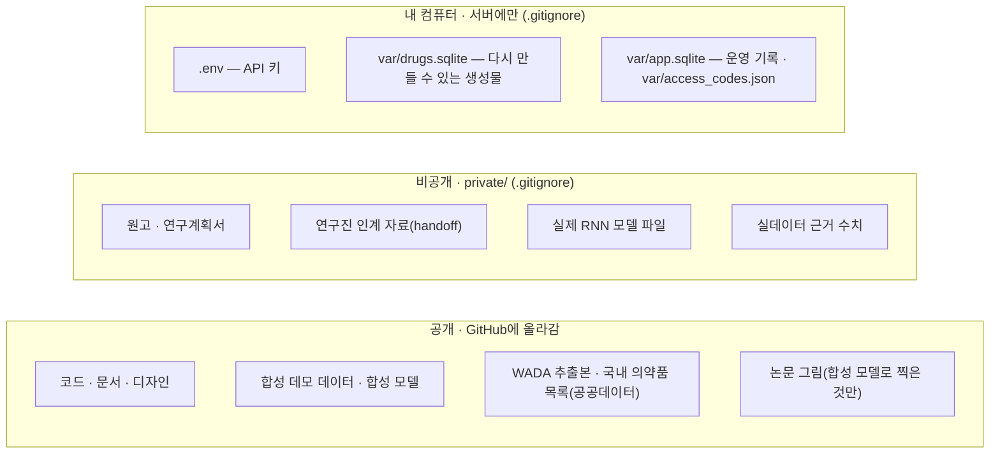

# AI 반도핑 맞춤형 교육 플랫폼

역도 선수가 최근 대회 기록을 넣으면, **연구진의 경기력 예측 모델 출력**을 바탕으로 교육 프로파일 태그를 붙이고, 그에 맞는 반도핑 교육·약물 확인 절차·AI 질의응답을 제공하는 연구용 반응형 웹입니다.

> 그림은 GitHub에서 바로 보입니다. VS Code 미리보기에서 보려면 확장 "Markdown Preview Mermaid Support"를 설치하세요.

**목차**
1. [한눈에 보기](#1-한눈에-보기)
2. [폴더 구조](#2-폴더-구조)
3. [데이터 흐름 ① 교육 프로파일](#3-데이터-흐름--교육-프로파일)
4. [데이터 흐름 ② 약물 확인](#4-데이터-흐름--약물-확인)
5. [데이터 흐름 ③ AI 교육](#5-데이터-흐름--ai-교육)
6. [자료는 어디서 오나](#6-자료는-어디서-오나)
7. [무엇이 어디에 저장되나](#7-무엇이-어디에-저장되나)
8. [공개와 비공개의 경계](#8-공개와-비공개의-경계)
9. [실행 모드: 데모와 시범](#9-실행-모드-데모와-시범)
10. [실행하기 · 더 읽을 문서](#10-실행하기--더-읽을-문서)

---

## 1. 한눈에 보기

사용자는 브라우저 하나로 쓰고, 서버 하나가 화면과 API를 함께 제공합니다. AI는 **두 곳**(경기력 예측, 답변 생성)에만 쓰이고, 태그 판정과 약물 판정은 규칙이 정합니다.



| 역할 | 쓸 수 있는 메뉴 |
|---|---|
| 선수 | 경기력 · 약물 확인 · AI 교육 · 시스템 구성 |
| 지도자, 선수지원인력 | 약물 확인 · AI 교육 · 시스템 구성 |

---

## 2. 폴더 구조

크게 **코드**(frontend · backend), **앱이 쓰는 자료**(knowledge), **실행하면 생기는 것**(var), **자료를 만드는 도구**(analysis), **문서·테스트**, **비공개** 여섯 덩어리입니다.

```
ai-antidoping-edu/
│
├── frontend/                 ── 웹 화면 (React · TypeScript)
│   └── src/
│       ├── pages/            화면 하나당 파일 하나
│       │   ├── Start.tsx         접근 코드 입력 · 데모 사용자 고르기
│       │   ├── ConsentPage.tsx   첫 진입 동의 화면
│       │   ├── Performance.tsx   경기력: 기록 입력 → 교육 프로파일
│       │   ├── Check.tsx         약물 확인
│       │   ├── Learn.tsx         AI 교육(질의응답)
│       │   └── Architecture.tsx  시스템 구성(발표용)
│       ├── components/       화면 조각(기록 입력표, 차트, 상태 배지 …)
│       ├── api.ts            서버 API 호출과 데이터 형식
│       └── styles/           디자인 토큰 · 공통 스타일
│
├── backend/                  ── 서버 (Python · FastAPI)
│   ├── app/
│   │   ├── main.py           서버 시작 · 시범 모드 시작 관문
│   │   ├── config.py         모든 설정(환경변수)
│   │   ├── schemas.py        API가 주고받는 데이터 형식
│   │   ├── api/
│   │   │   ├── session.py    접근 코드 로그인 · 역할
│   │   │   ├── routes.py     경기력 · 약물 확인 · AI 교육 API
│   │   │   └── usage.py      동의 · 사용 기록 · 일일 상한 · 대화 서명
│   │   ├── profiling.py      교육 프로파일: 입력 검증 → 예측 → 태그 규칙
│   │   ├── rnn_infer.py      연구진 RNN 모델로 예측(출력만 사용)
│   │   ├── profiles.py       태그 → 추천 교육 연결
│   │   ├── substances.py     약물 판정(조회표 → 상태)
│   │   ├── drug_db.py        약물 DB 만들기 · 읽기
│   │   ├── app_db.py         운영 DB(동의 · 가명 사용 기록)
│   │   ├── rag/retrieve.py   교육 자료 검색(BM25)
│   │   └── llm/
│   │       ├── guard.py      질문 점검(강요 · 회피) · 인용 검증
│   │       ├── prompts.py    AI에게 줄 지시문 만들기
│   │       └── client.py     Claude API 호출
│   └── tests/                자동 테스트(약 330개)
│
├── knowledge/                ── AI·판정이 보는 자료. 폴더마다 raw(받은 원본, Git 제외) / processed(가공본)
│   ├── drugs/                약물 → 약물 확인 판정 규칙이 씀(AI 아님)
│   │   ├── wada/             raw: WADA 2026 금지목록 PDF → processed: 금지목록 JSON · 손 보정 yaml
│   │   ├── kada/             raw: KADA 금지목록 국문 · 한약재 · 보충제 · TUE 질환별 가이드 → processed: (아직 없음)
│   │   ├── kr_source/        raw: 심평원 약가마스터 CSV → processed: 국내 의약품 목록(kr_products.json.gz)
│   │   └── curated/          사람이 직접 만든 조회표 → substances.json(성분) · products.json(제품군)
│   └── education/            교육 → 레슨(.md)이 들어올 자리, AI 근거 · "교육 자료" 화면
│       └── raw/              WADA ISE·Athlete Curriculum · ADEL · KADA 교육 자료 원본
│
├── backend/settings/         ── 판단 기준표 · 추천 교육 연결 · 검색 동의어 · 예측 설정(합성)
├── backend/demo/             ── 연습용 → 데모 사용자 · 테스트 시나리오 · AI 답변 녹화
│
├── var/                      ── 실행하면 생기는 것(Git 제외)
│   ├── drugs.sqlite          약물 DB — knowledge/drugs/에서 자동으로 만듦
│   ├── app.sqlite            운영 기록 — 가명 사용 기록
│   └── access_codes.json     시범용 접근 코드(연구진 발급)
│
├── analysis/                 ── 자료를 만드는 도구(서버가 실행하지 않음)
│   ├── wada_extract.py       WADA PDF → JSON(손 보정은 knowledge/drugs/wada/processed/)
│   ├── kr_drug_names.py      심평원 CSV → 국내 의약품 목록
│   ├── make_synthetic.py · predict.py · export.py   합성 데모 데이터·모델
│   ├── scenarios.py          테스트 시나리오 14개
│
├── e2e/                      ── 브라우저 자동 점검(화면 캡처 · 시나리오 · 접근성)
├── scripts/test-servers.sh   ── 테스트 서버 두 개 켜기
├── docs/                     ── 문서(설계 결정, 테스트 안내, WADA 검토 기록, 논문 그림)
├── DESIGN.md                 ── 화면 디자인 규칙
├── Dockerfile · compose*.yaml ── 배포용(데모 · 시범)
│
├── private/                  ── 비공개(Git에 올라가지 않음): 원고 · 연구진 인계 자료 · 실제 모델
└── .env                      ── 비공개(Git에 올라가지 않음): API 키
```

---

## 3. 데이터 흐름 ① 교육 프로파일

선수가 기록을 넣고 버튼을 누르면 일어나는 일입니다. **입력한 기록은 계산에만 쓰고 저장하지 않습니다.**



- **점수가 아니라 태그**입니다. "위험·의심" 같은 표현은 쓰지 않습니다.
- 여자 선수는 연구진 모델이 없어 기록만 보여주고, 향상·감소 태그는 붙이지 않습니다.

---

## 4. 데이터 흐름 ② 약물 확인

**판정은 조회표가 하고, AI는 판정하지 않습니다.** "허용" 판정은 없고, 언제나 KADA 확인을 안내합니다.



| 상태 배지 | 뜻 |
|---|---|
| 금지 | 항상 금지 |
| 경기기간 중 금지 | 경기기간에만 금지 |
| 기준을 넘으면 금지 | 소변 농도·용량 기준이 있음(예: 슈도에페드린) |
| 조건에 따라 금지 아닐 수 있음 | 투여 경로·용도 조건이 있음(예: 점안제) |
| 목록에서 확인되지 않음 · 확인 필요 | 목록에 없음 ≠ 허용 |
| 성분 확인 필요 | 판정할 수 없음 |

같은 성분이라도 **투여 경로**에 따라 달라집니다. 예를 들어 스테로이드는 먹는 약·주사는 경기기간 중 금지, 바르는 약은 조건부입니다.

---

## 5. 데이터 흐름 ③ AI 교육

질문은 여러 단계의 점검을 거쳐야 Claude API에 닿습니다.



Claude API로 나가는 것은 **질문, 태그·나이대·대회 수준, 검색된 공식 자료**뿐입니다. 이름과 대회 기록 원본은 나가지 않습니다.

---

## 6. 자료는 어디서 오나

서버는 미리 만들어 둔 자료를 읽기만 합니다. 자료를 만드는 일은 `analysis/` 도구가 따로 합니다.



- **연구진 모델:** 연구진 것입니다. 플랫폼은 출력만 쓰고 성능에 개입하지 않습니다. 지금 모델은 인계본에 학습된 파일이 없어 임시로 만든 것이라, 연구진 모델을 받으면 교체합니다.
- **검토 표시:** 모든 자료에는 사람 검토 여부(`reviewed`)가 붙어 있습니다. 검토 전 자료가 있으면 시범 서버는 시작되지 않습니다.

---

## 7. 무엇이 어디에 저장되나



가명은 접근 코드를 비밀 키로 바꾼 값이라, 코드 없이는 누구인지 되돌릴 수 없습니다.

---

## 8. 공개와 비공개의 경계

이 저장소는 **공개**입니다. 그래서 파일을 세 구역으로 나눕니다.



---

## 9. 실행 모드: 데모와 시범

| | 데모 (`DEMO_MODE=1`, 기본) | 시범 (`DEMO_MODE=0`) |
|---|---|---|
| 누가 | 연구진 · 발표 · 테스트 | 실제 선수 |
| 로그인 | 데모 사용자 버튼(선수 A~E 등) | 연구진이 발급한 접근 코드 |
| 예측 모델 | 합성 모델 또는 연구진 RNN | 연구진 RNN만 |
| 테스트 시나리오 · 판정 점검표 | 보임 | 숨김 |
| 동의 화면 | 끔(`CONSENT_REQUIRED=1`로 미리 보기) | 항상 |
| 시작 관문 | 없음 | 아래가 하나라도 걸리면 **서버가 시작을 거부** |

시범 시작 관문:
- 세션 비밀값이 32자 이상
- 모든 자료가 사람 검토 완료
- 예측 모델이 실제 데이터 기준
- 금지목록이 유효기간 안

---

## 10. 실행하기 · 더 읽을 문서

```bash
./scripts/test-servers.sh
# 합성 모델:  http://127.0.0.1:8101
# 연구진 RNN: http://127.0.0.1:8102   (private/models가 있을 때만)
```

- 실제 AI 답변을 보려면 레포 루트의 `.env`에 `ANTHROPIC_API_KEY`와 `LLM_MODE=live`를 넣습니다. 조직 키라면 `ANTHROPIC_WORKSPACE_ID`도 넣습니다.
- 키가 없으면 고정된 연습 답변(mock)으로 동작합니다.

| 문서 | 내용 |
|---|---|
| [docs/TESTING.md](docs/TESTING.md) | 테스트 방법 · 시나리오 목록 · 시범용 기능 확인 |
| [docs/design/DESIGN-DECISIONS.md](docs/design/DESIGN-DECISIONS.md) | 설계 결정 D1~D33 · 시범 관문 · 확인할 것 |
| [DESIGN.md](DESIGN.md) | 화면 디자인 규칙 · 상태 배지 · 금지어 |
| [docs/WADA-REVIEW.md](docs/WADA-REVIEW.md) | WADA 추출본 검토 기록 · 사람 검토 서명란 |
