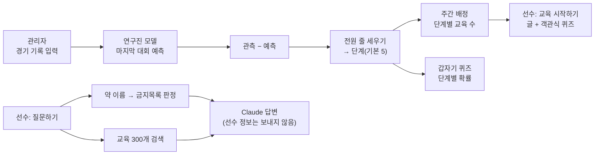

# AI 반도핑 교육 플랫폼

역도 선수(남자)를 위한 도핑방지 교육 웹사이트. 연구진 경기력 예측 모델의 결과로 선수들을 단계로 나누고, 단계가 높을수록 한 주에 더 많은 교육과 퀴즈를 줍니다. 선수는 **교육 시작하기**와 **질문하기**(그리고 내 학습 기록·사용 설명서)를 쓰고, 관리자는 선수 기록을 넣고 진행 상황을 봅니다.

연구용 프로토타입입니다. 지금까지 정한 것은 아래 [7절](#7-정해-둔-것), 화면 규칙은 [DESIGN.md](DESIGN.md), 자료 지도는 [knowledge/README.md](knowledge/README.md).

## 1. 한눈에 보기



| 누가 | 하는 일 |
|---|---|
| 관리자 | 선수 등록(로그인 코드 발급, 가입 없음) · 경기 기록 입력 · 단계 설정 · 선수별 이수/퀴즈/오답 남음/질문 보기 · CSV 내보내기 · 교육 자료 열람과 사람 검토(검토 완료·고칠 곳 메모) · 질문하기 |
| 선수 | 일주일에 한 번 접속 → 이번 주 교육(글 + 퀴즈 1문항) · 갑자기 퀴즈 · 질문하기 · 내 학습 기록(오답 다시 풀기) · 사용 설명서 |

**단계 나누기**: 모델의 관측 − 예측(kg)이 큰 선수, 즉 예측보다 기록이 많이 오른 선수가 앞. 모델 결과가 없는 선수(기록 부족)는 맨 뒤. 전체 인원을 단계 수로 고르게 나눕니다(100명·5단계면 20명씩). 기본값은 [backend/settings/program.yaml](backend/settings/program.yaml), 관리자가 화면에서 바꿉니다.

| 단계 | 주당 교육 | 갑자기 퀴즈 확률(하루 첫 접속) | 문항 수 |
|---|---|---|---|
| 5 (가장 높음) | 15 | 80% | 3 |
| 4 | 12 | 65% | 3 |
| 3 | 9 | 50% | 2 |
| 2 | 6 | 35% | 2 |
| 1 | 3 | 20% | 1 |

## 2. 폴더 구조

```
ai-antidoping-edu/
├── frontend/              화면 (React · TypeScript)
│   └── src/pages/         Login(로그인) · Ask(질문하기 — 선수·관리자 함께)
│                          athlete/ Home(이번 주 교육) · Lesson(교육+퀴즈) · History(내 학습 기록·오답 다시 풀기) · Guide(사용 설명서)
│                          admin/   AdminAthletes(선수 표) · AdminAthlete(상세·기록) · AdminSettings(단계) · Library(교육 자료) · Architecture(시스템 구성)
├── backend/               서버 (Python · FastAPI)
│   ├── app/
│   │   ├── api/           login · athlete · admin · chat · library — 화면이 부르는 주소
│   │   ├── db/            운영 DB(var/app.sqlite) 표 정의 schema.sql
│   │   ├── program/       lessons(300개 읽기·순서) · tiers(줄 세우기·단계) · weekly(주간 배정) · quiz(채점·갑자기 퀴즈)
│   │   ├── model/         연구진 모델 결과 모양(adapter) · 예측 계산(predict) · RNN numpy 추론
│   │   ├── drugs/         약물 판정(substances) · 약물 DB(drug_db)
│   │   └── chat/          retrieve(교육 검색) · drug_lookup(질문 속 약 이름) · prompts · guard(질문 점검) · client(Claude 호출)
│   ├── settings/          단계 기본값 · 검색 동의어 · 공개용 합성 모델
│   └── tests/             자동 테스트
├── knowledge/             자료. 출처마다 raw/(받은 원본, Git 제외) → processed/(가공본) — 자세한 지도는 knowledge/README.md
│   ├── drugs/             wada · kada · kr_source(심평원) + curated(사람이 만든 조회표)
│   └── education/         lessons/(교육 300개, A~M 13개 대분류) + raw/(WADA ISE·Athlete Curriculum·ADEL·KADA 자료)
├── scripts/               run.sh(서버 켜기) · seed_dummy.py(더미 선수 100명) · redteam.py(까다로운 질문 50개를 실제 AI로) · apply_reviews.py(화면의 검토 표시를 레슨 파일에 반영)
│                          build_wada.py · build_kada.py · build_kr_source.py(raw → processed)
├── private/               비공개(Git 제외): 연구진 인계 자료 · 원고 · 실제 모델
└── var/                   실행하면 생김(Git 제외): 운영 DB · 약물 DB · 더미 로그인 코드
```

## 3. 교육 300개

`knowledge/education/lessons/<대분류>/<id>.md` — 레슨 하나 = 텍스트 설명 + 객관식 퀴즈 1문항. 형식은 [knowledge/education/README.md](knowledge/education/README.md).

대분류 13개는 WADA 교육 국제표준(ISE 2027) 필수 주제 12개 + 대회 전 교육이고, 순서는 WADA ADEL 국제 선수 과정을 따릅니다. 모든 소제목 끝에 근거 문서(`출처:`)가 있습니다.

| 대분류 | 수 | 대분류 | 수 |
|---|---|---|---|
| A 클린스포츠 가치 | 25 | H 의약품·TUE | 40 |
| B 도핑방지 체계 | 15 | I 비의도적 도핑(보충제·한약) | 30 |
| C 권리와 책임 | 20 | J 검사 절차 | 30 |
| D 엄격책임 | 10 | K 소재지정보 | 15 |
| E 도핑방지규정위반 | 25 | L 제보 | 10 |
| F 결과·결과관리 | 25 | M 대회 전 교육 | 10 |
| G 금지목록 | 45 | **합계** | **300** |

## 4. 질문하기

- 질문 속 낱말을 약물 조회표에서 찾아, 제품명(타이레놀)이든 성분명(아세트아미노펜)이든 같은 판정을 근거로 넣습니다. 같은 이름의 제품이 여럿이면 제품별 성분과 판정을 함께 넣습니다.
- AI는 선수의 이름·기록·단계·종목을 모릅니다. 그래서 평소/경기기간 중 금지 여부를 둘 다 말하고, 종목마다 다른 규정(P1 베타차단제 등)은 "종목마다 다르다"고 답합니다.
- 답변 아래에는 조회표 판정 원본을 카드로 따로 보여 줍니다(AI 설명과 대조용, 추가 비용 없음). 별도의 약물 확인 화면은 없습니다. 한약재는 KADA 한약재 가이드라인의 11종을 판정합니다.
- 답에 인용된 교육은 "관련 교육"으로 추천하고(이번 주 목록 밖이어도 열어 읽고 퀴즈를 풀면 이수), 출처를 누르면 WADA·KADA 원문이 새 창으로 열립니다.
- 근거 검색은 "먹어도 돼" 같은 흔한 말을 빼고 찾고, 최고점보다 많이 낮은 조각은 넣지 않습니다. 약 이름이 있으면 성분 이름으로도 찾고 교육 조각은 3개만 넣습니다(토큰 절약).
- 검사 회피·강요 질문은 AI를 부르지 않고 고정 응답. 근거 없는 답은 내보내지 않습니다.
- 질문과 답은 운영 DB에 저장되고 관리자가 선수별로 봅니다.

## 5. 저장되는 것

| 어디 | 무엇 |
|---|---|
| `var/app.sqlite` (운영 DB) | 선수(번호·이름·출생연도·코드 해시) · 관리자 · 경기 기록 · 모델 결과 · 단계 설정과 배정 · 교육 배정과 이수 · 퀴즈(교육·갑자기·오답 다시 풀기) · 갑자기 퀴즈 출제 · 질문과 답 · 접속 · 교육 자료 사람 검토 표시 |
| 저장하지 않음 | 로그인 코드 원문(해시만) |
| Claude API로 보내는 것 | 질문 · 직전 대화 2번(질문과 답) · 검색된 교육 조각 · 약물 판정 |

## 6. 실행하기

처음 한 번(Python 3.12 이상, Node 24 이상):

```bash
cd backend && python3 -m venv .venv && .venv/bin/pip install -r requirements.lock && .venv/bin/pip install -e ".[dev]"
cd ../frontend && npm ci
# 자료를 다시 만들 때만: build_wada.py는 cd backend && .venv/bin/pip install -e ".[scripts]"(PyMuPDF), build_kada.py는 pdftotext(poppler)
```

그다음부터:

```bash
./scripts/run.sh          # http://127.0.0.1:8100 — 서버 하나(화면 + API)
```

- 처음 실행하면 더미 선수 100명(남자 역도, 경기 기록만)을 넣고 모델을 돌려 단계를 매깁니다. 로그인 코드는 `var/dummy_codes.csv`, 데모에서는 로그인 화면 오른쪽에도 보입니다.
- 모델: `private/models`(연구진 모델, 비공개)가 있으면 그것을, 없으면 공개용 합성 모델을 씁니다.
- AI 답변: 기본은 키 없이 도는 mock. 레포 루트 `.env`에 `ANTHROPIC_API_KEY=…`와 `LLM_MODE=live`를 넣으면 실제 답변.
- 테스트: `cd backend && .venv/bin/python -m pytest -q`
- Docker: `docker compose up --build` → http://localhost:8100, 더미 선수는 `docker compose exec app python /app/scripts/seed_dummy.py`

## 7. 정해 둔 것

사용자가 정한 것과 날짜. 설계 문서(docs/)는 Claude가 쓴 것이라 2026-10-23에 지웠고, 남길 결정만 여기 옮겼다.

- **대상·역할**: 남자 역도 선수. 선수/관리자 두 역할, 가입 없음 — 관리자가 선수를 등록하면 로그인 코드가 나온다(2026-10-18).
- **모델**: 연구진 것이다. 플랫폼은 결과(관측 − 예측)만 쓰고 학습·조정하지 않는다. 여자 모델은 구현하지 않는다. 지금 `private/models`의 남자 RNN은 연구진 묶음이 올 때까지의 임시본(2026-10-12, 10-17).
- **단계**: 관측 − 예측이 큰 순으로 줄 세우고, 결과가 없으면 가장 낮은 단계. 단계가 높을수록 교육 수·퀴즈 빈도만 많고 내용은 같다(2026-10-18). 급격한 향상·감소의 기준은 정하지 않았다(지금은 쓰지 않음).
- **교육**: 300개, 텍스트 설명 + 객관식 1문항. 갑자기 퀴즈는 배운 교육에서만. 내 학습 기록·오답 다시 풀기(2026-10-18, 10-23).
- **질문하기**: 선수의 이름·기록·단계는 AI에 보내지 않는다. AI는 종목을 모르므로 종목마다 다른 규정은 "종목마다 다르다", 평소/경기기간 중은 둘 다 말한다. 질문 원문은 저장되고 관리자가 본다(선수에게 따로 알리지 않음). 약물 확인 화면은 질문하기로 합쳤다(2026-10-18).
- **넣지 않는 문구**: "KADA에서 확인하세요", "전문가·의사에게 확인하세요" 같은 다시 확인하라는 문장, 도움 요청 안내, 동의서, 위기 안내(2026-10-17). 관련 교육 추천과 원문 링크는 넣는다(2026-10-18). 레슨 안에서 KADA가 안내하는 내용을 사실로 옮기는 것(예: "부작용이 있으면 진료를 받으라고 안내해요")은 괜찮다(2026-10-23).
- **레슨 근거**: 원문끼리 다르면 한국도핑방지규정(2021)과 2026 금지목록을 따른다. 2025 사례집(도핑사례 길라잡이) Q&A는 사례집 스스로 가상 사례라고 밝혀 가정형으로만 쓴다. 원문에 없는 문장은 넣지 않는다. 300개를 AI로 두 번 대조했다(2026-10-23, 1차 82개·2차 143개 수정).
- **비용**: 답변 생성은 effort low · 최대 1200 토큰 · 직전 대화 2번만(2026-10-18). 같은 질문 답 저장(캐시)과 사용량 기록은 하지 않는다.
- **자료**: 원본(raw)과 가공본(processed)을 나누고 원본은 Git에 올리지 않는다. 저장소는 공개, 원고·실데이터·연구계획서·연구진 자료는 `private/`에만.
- **서버**: 하나(8100). 8000은 다른 프로젝트가 쓴다. 알림은 보류(2026-10-23).
- **검토**: 레슨·약물 표·WADA 추출본이 모두 `reviewed: false`. 시범 모드(`DEMO_MODE=0`)는 실제 모델·사람 검토·금지목록 유효기간·비밀키가 갖춰져야 켜진다 — 이 관문은 이전 Claude 세션이 만든 것이다. WADA 추출본 검토지는 `knowledge/drugs/wada/REVIEW.md`.

